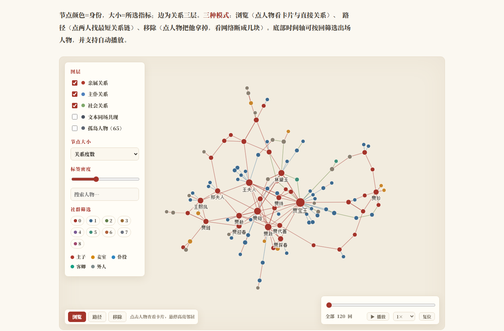
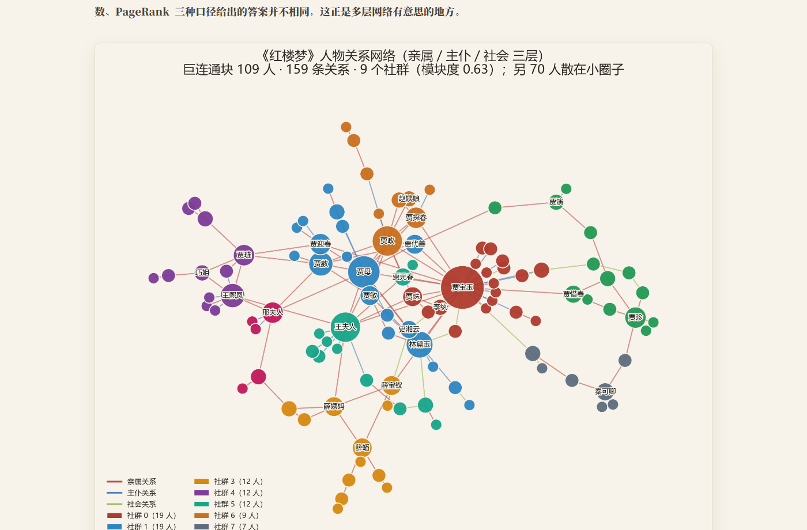
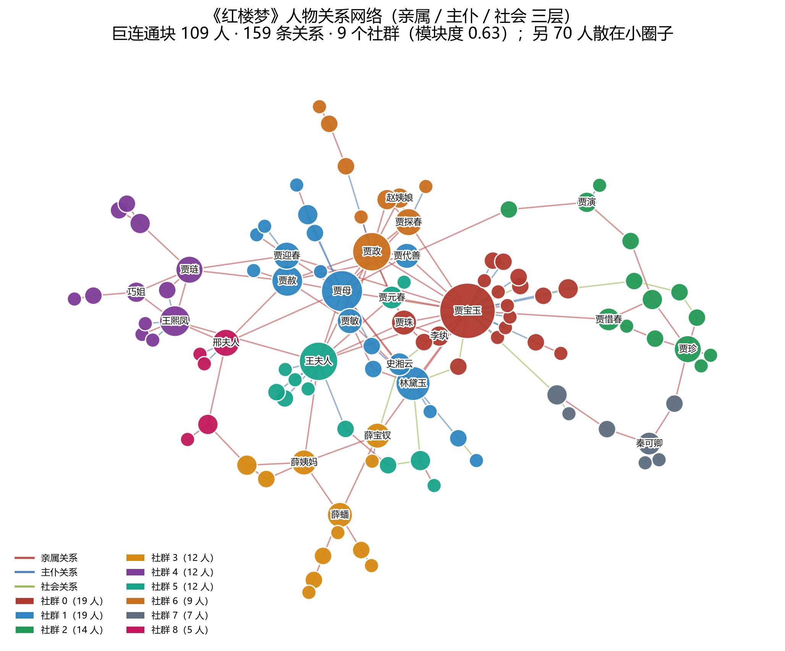

# 红楼梦人物网络 · 多模态分析

> 把一份"部分数据、待清洗"的《红楼梦》人物数据集，洗成 179 人 / 348 条关系的可计算网络，
> 再接上 120 回全文与 128 张可确认的人物图，做成一个**四层（亲属—主仆—社会—文本）多模态网络分析**。

**在线浏览（交互图 + 图文分析）**：<https://woaadan.github.io/hlm-network/>


| 交互网络（浏览 / 路径 / 移除 / 回目时间轴） | 结构分析 |
|---|---|
|  |  |



---

## 一、做了什么

原始数据集给了三张表 + 178 张图，标注"待清洗"。实际检查后发现的问题比预期多：

| 问题 | 规模 | 处理 |
|---|---|---|
| 性别缺失 | 117 / 179 | 按亲属谓词、主仆谓词、原文考订逐条补齐，现 179/179 完整 |
| 身份"未标注" | 133 / 179 | 重建为 主子 / 妾室 / 仆役 / 宗族 / 客卿 / 外人 六类，另加"身份细分" |
| 与关系网络完全断开 | 75 人 | 补 23 条文本可证的缺边；再用同场共现接回 59 人（32 人达到 ≥3 次稳定同场） |
| 同图多人（MD5 相同） | 20 组 / 39 人 | 一人一图收敛；无法判定归属的整组标"图源冲突"，不硬凑 |
| 图不对人 | 20 张 | 逐张目视复核：书封、鸳鸯/鹦鹉/琥珀等"望文生义图"、雕像、拼图、鬼畜截图，标"非人物像"并从展示中剔除 |
| 世系错误 | 惜春记作贾珍之女、尤氏记作其母 | 订正为贾敬之女、尤氏为嫂 |
| 婚向反了 | 迎春—孙绍祖、岫烟—薛蝌 | 订正方向 |
| 实体重复 | 琪官＝蒋玉菡、尤老娘＝尤氏继母 | 合并实体、保留别名 |
| 谓词同义异写 | 70 余种（丫环/丫头/大丫头/陪房丫头…） | 规范到 40 种标准谓词，并自动生成互逆边 |

清洗后：**179 人 · 348 条有向关系（已配对 293）· 0 空值**，每条修改都能在
`data/curation/person_curation.csv` 里追到"谁、依据什么"。

补充进来的新数据：

- **120 回全文**（85 万字，公开 120 回本）→ 人物提及、出场回次、同场共现、关系边的文本证据；
- **结局表**（44 人，据 120 回本）→ 用于"网络位置 × 命运"的对照；
- **2 个缺失人物**（周姨娘、文官）→ 补齐贾政妾室与"十二官"；
- **图像低层特征**（亮度、饱和度、色彩丰富度、边缘密度、主色相）。

## 二、主要发现

**1. 关系网络是"薄而宽"的小世界。**
179 人里 65 人孤立，巨连通块 109 人、密度 0.0102，但直径只有 9 跳、平均路径 4.0。
k-core 只有 3 层——核心不是层层嵌套，而是一个扁平核心圈加大量卫星人物。

**2. 贾宝玉是唯一的结构洞占有者。**
度 28、介数 0.214、有效规模 26.5、约束度 0.063，三项都是第一且断层领先。
删掉他，巨连通块从 109 掉到 96；删掉薛蟠（度仅 5）也会掉 7——后者靠"薛家—贾家"的姻亲
成为另一处窄门。

**3. 社群 ≈ 房头，而不是府邸。**
Louvain 得到 9 个社群，模块度 0.632。它们几乎逐个对应"房"：宁国府、薛家、凤姐—琏二房、
王夫人—元春、贾政—赵姨娘、秦可卿—秦家、邢夫人—邢家，以及被单独切出来的"怡红院系"。
社群与居所的 NMI 只有 0.329——同一座荣国府内部被切成 5 段。
**切分网络的不是"住在哪"，而是"跟着谁吃饭"。**

**4. 文本层的模块度只有 0.144。**
同样做 Louvain，同场共现网络的模块度只有 0.144，远低于关系层的 0.632。
小说的"舞台"本身高度整合（宝玉几乎和所有人同场），真正把社会切开的是制度性关系。
**表层人情 vs 里层宗法**，这个落差可以被量化。

**5. 被表格漏掉的人，恰恰是大丫鬟。**
原表 65 个孤岛里有平儿、紫鹃、司棋、待书、抱琴、鸳鸯——不是她们不重要，而是编表时
"只记主仆、不记丫鬟之间的网络"。补边后平儿的度从 0 升到 2，紫鹃 0→1，
文本层又让 59 人回到主网。

**6. 前 80 回与后 40 回的人物戏份总体连续。**
Spearman ρ=0.63，前 20 名重合 14 人。这是"同一舞台的延续"的量化证据；
但**不足以单独判定作者归属**，只能作为一个侧面的辅助指标。

**7. 图像模态的诚实结论：脸解释不了位置。**
剧照的亮度、饱和度与身份、网络位置几乎不相关（度—饱和度 r=0.02）；
唯一显著的是边缘密度（p=0.02），更可能来自构图景别。
真正有信息的是**"谁有图"**：仆役的图源冲突率远高于主子——知识库的偏差本身就是一个发现。

## 三、仓库结构

```
hlm-network/
├── data/
│   ├── raw/                 原始三表 + 178 图（未改动）
│   ├── external/            120 回全文、分回 txt、章节索引
│   ├── curation/            人工考订明细（可审计）
│   └── processed/           清洗后人物/关系/结局、文本统计、共现、节点指标
├── scripts/
│   ├── 00_audit.py          原始数据体检
│   ├── 02_clean.py          清洗＋增补（人工考订在 curation_data.py）
│   ├── 03_text.py           全文解析、提及识别、同回/同场共现
│   ├── 04_images.py         图像去重、错图判定、视觉特征
│   ├── 05_network.py        网络指标、社群、桥接、时序、跨模态
│   ├── 06_figures.py        11 张静态图
│   └── 07_web.py            生成 docs/index.html（数据内嵌，单文件）
├── figures/                 静态图
├── docs/                    可直接托管的网页（GitHub Pages）
└── requirements.txt
```

## 四、复现

```bash
pip install -r requirements.txt

python scripts/00_audit.py      # 可选：体检原始数据
python scripts/02_clean.py      # 清洗 + 增补
python scripts/03_text.py       # 全文 → 提及 / 共现
python scripts/04_images.py     # 图像去重 + 特征
python scripts/05_network.py    # 网络分析
python scripts/06_figures.py    # 静态图
python scripts/07_web.py        # 网页
```

依赖：`pandas numpy networkx scipy matplotlib pillow openpyxl`。
中文图需系统里有 SimSun / Microsoft YaHei / Noto Serif CJK 之一。

## 五、方法与口径

- **人物识别**：别名词典（标准名 + 别名 + 雅号 + 去姓简称）+ 最长匹配；
  对"珍珠、琥珀、翡翠、玻璃、彩云、彩霞"等兼作普通名词的称呼加 5 字上下文过滤。
- **两套共现**：章回级（用于"文本证据"）与 400 字滑动窗口（近似"同场"，用于文本网络）。
- **社区发现**：Louvain（关系层在巨连通块内做，避免孤立点把模块度推高）。
- **中心性**：degree / betweenness / eigenvector / PageRank / k-core / 结构洞（constraint、effective size）。
- **布局**：自实现 ForceAtlas2（`scripts/lib_layout.py`），静态图与网页共用同一套坐标算法。
- **跨模态**：Mann-Whitney U 检验 + Pearson 相关；样本量小的地方只作描述不作推断。

## 六、数据字典（`data/processed/`）

| 文件 | 说明 |
|---|---|
| `persons.csv` | 179 人：标准名、别名、性别、血缘家族、居所、身份类别/细分、图像状态、校注 |
| `relations.csv` | 348 条：主体/客体、规范谓词、关系大类、互逆、是否派生、来源、同回共现（文本证据） |
| `fates.csv` | 44 人结局与结局回目 |
| `person_chapter.csv` | 人物 × 回 的提及次数 |
| `cooccurrence.csv` / `cooccurrence_scene.csv` | 同回共现 / 同场共现 |
| `node_metrics.csv` | 节点级全部指标（含多层度、社群、文本度、图像特征、结局） |
| `chapter_metrics.csv` / `block_metrics.csv` | 120 回与 12 个十年块的网络指标 |
| `network_summary.json` | 全局指标汇总（网页与图表的数据源） |
| `image_features.csv` | 148 张图的视觉特征 |
| `image_conflicts.json` | 20 组同图冲突的去向记录 |

## 七、局限

1. 人物识别基于词典，别名遗漏会造成漏计（尤其以"二爷""大奶奶"等称谓出现时）。
2. 400 字窗口是"阅读经验"的近似，不是真正的场景切分。
3. 结局与部分补充关系为人工整理，依据 120 回通行本；不同版本会有出入。
4. 20 组同图冲突只做了"一人一图"收敛，未做真人识别。
5. 前 80 / 后 40 回的对比只说明文本连续性，不构成作者归属判定。

## 八、许可与致谢

- 代码：MIT。
- 清洗后数据：CC BY-NC-SA 4.0（仅限研究与教学）。
- 原始数据：用户提供的《红楼梦》（部分数据、待清洗）数据集。
- 全文：公开的 120 回通行本。图源：原数据集附带剧照，版权归原权利人，此处仅作研究示例。

如果这个仓库对你有用，欢迎 star；也欢迎提 issue 补充人物关系与别名。


## 附：进阶分析（v2 新增）

- **社群间连接**：97 条社群内部边之外有 36 条跨社群边（37%），且高度集中于宝玉（12）、贾政（8）、王夫人（6）、贾母（5）——房与房之间的往来由少数家长承担。
- **主仆二部图**：宝玉班底 11 人、王夫人 6 人、贾母 4 人；全府只有一对主子共用仆人（贾母与黛玉共用紫鹃），说明主仆归属近乎刚性。
- **结构洞**：宝玉有效规模 26.5、约束度 0.063，是唯一的全局"经纪人"；薛家诸人则聚在"高约束—低有效规模"角落。
- **命运 × 位置**：死亡组介数中位数最低（0.0068），出家组最高（0.027）；戏份多少与退场早晚无关。
- **时序中心性**：按十年块重建同场网络，宝玉介数在 71–80 回后明显下滑——抄检大观园之后他不再是各房必经之路。

## 交互功能（网页）

- **浏览**：点人物看卡片（画像、六项指标、结局）与**直接关系列表**，点关系可跳到对方。
- **路径**：点两个人，BFS 找最短关系链并在图上高亮，例如"黛玉 → 宝玉 → 贾政 → 贾母"。
- **移除**：点人物把他从网络中拿掉，实时看连通块如何碎裂——这是割点实验的交互版。
- **时间轴**：拖动 1–120 回，只显示该回出场的人；支持自动播放，看图如何随回目重组。
- **社群筛选**：点面板里的社群编号开关某一房；配合"节点大小"可切换度 / 介数 / 文本度 / k-core。
- **悬停聚焦**：鼠标停在某人身上，只高亮他的邻居，其余变淡，并弹出跟随式提示。

